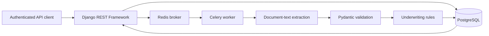

# Loan Processing Platform

Backend application for authenticated loan submission, document-text extraction, asynchronous processing, and rule-based underwriting recommendations. Built with Django REST Framework, PostgreSQL, Redis, Celery, Pydantic, and optional OpenAI extraction.

The repository includes an API, background worker, database migrations, automated tests, and benchmark scripts. **The underwriting output is a demonstration recommendation, not a production lending decision.**

## Features

- Authenticated REST API using Django REST Framework session and HTTP Basic authentication
- Owner-scoped access to loan applications, documents, processing jobs, and underwriting recommendations; staff can review all loans
- Server-assigned loan ownership and staff-only visibility for unassigned legacy loans
- Draft-only submission, required-document validation, and duplicate-submission rejection
- Celery background processing through Redis, dispatched after the loan transaction commits
- Deterministic mock extraction for local development and tests, with optional OpenAI extraction
- Pydantic validation of structured extraction results
- Rule-based underwriting based on income, liabilities, and risk indicators
- Processing-job status, retry attempts, safe error recording, and saved recommendations in PostgreSQL
- Non-root Docker application processes, OpenAPI/Swagger documentation, and benchmark scripts

## Architecture



**Processing path:** An authenticated user creates a loan, attaches document text, and submits the draft. The API commits the submission and queues a processing job. Celery extracts structured fields, runs the underwriting rules, and stores the recommendation and final state. The client retrieves the job and loan statuses through the API.

The worker handles retryable exceptions with Celery autoretry (up to three retries). Exhausted retries mark the job `failed` and return the loan to `review`. Completed jobs are not reprocessed by sequential duplicate deliveries. Unexpected worker-crash recovery and simultaneous-worker behavior require additional hardening and testing.

## Tech stack

| Layer | Technologies |
|---|---|
| API | Python 3.12, Django 5, Django REST Framework, drf-spectacular |
| Database | PostgreSQL 16, Django ORM |
| Background jobs | Celery, Redis 7 |
| Extraction and validation | Pydantic, optional OpenAI API |
| Runtime and development | Docker Compose, Gunicorn |
| Tests and benchmarks | pytest, pytest-django, Locust, custom Python scripts |

## Getting started

### Prerequisites

Python 3.12 and Docker with Compose. The development setup uses host ports **5433** (PostgreSQL), **6379** (Redis), and **8000** (API). If these ports are already in use, change this project's port mappings; do not stop unrelated projects or containers.

### 1. Configure the environment

```bash
cp .env.example .env
```

Use local-only credentials and keep `USE_FAKE_AI=true` for development. Leave `OPENAI_API_KEY` unset unless intentionally testing paid extraction. Never commit `.env`.

**Docker Compose:** The `web` and `worker` services explicitly use `db:5432` and `redis:6379` on the project's internal Docker network. Their values override the host addresses in `.env`.

**Running Python on the Mac/host:** With PostgreSQL and Redis running in Docker, use these values in the local `.env`:

```dotenv
POSTGRES_HOST=127.0.0.1
POSTGRES_PORT=5433
REDIS_URL=redis://127.0.0.1:6379/0
USE_FAKE_AI=true
```

### 2. Start the full Docker stack (recommended)

```bash
docker compose up -d --build

docker compose ps
docker compose logs --tail=25 web
docker compose logs --tail=25 worker
```

The web startup runs committed Django migrations before starting Gunicorn; it does **not** generate migrations automatically. The web and worker images run as the non-root `appuser` (UID 10001).

To verify:

```bash
docker compose exec -T web python manage.py check
docker compose exec -T worker celery -A config inspect ping
```

Avoid `docker compose down -v` unless you explicitly intend to delete this project's database volume.

### Alternative: Run Django and Celery on the host

Start only the dependencies:

```bash
docker compose up -d db redis
python3.12 -m venv .venv
source .venv/bin/activate
python -m pip install -r requirements.txt
python manage.py migrate
```

Start the API in one terminal:

```bash
python manage.py runserver 127.0.0.1:8000
```

Start the worker in a second terminal with the virtual environment activated:

```bash
celery -A config worker -l info --pool=solo
```

### 3. Create a local API user

Authentication is required. To create a non-staff user for local testing using the Docker web container:

```bash
docker compose exec -T web python manage.py shell -c "from django.contrib.auth import get_user_model; User = get_user_model(); User.objects.create_user(username='demo_user', password='replace-with-a-unique-local-password')"
```

Replace the example password before running the command. The example command creates a new user and will fail if `demo_user` already exists. For the host-based setup, run the equivalent `python manage.py shell -c ...` command. Use only synthetic applicant and document data.

### API documentation

- Swagger UI: http://127.0.0.1:8000/api/docs/
- OpenAPI schema: http://127.0.0.1:8000/api/schema/

## Example authenticated API flow

These requests use **HTTP Basic authentication for local development**. Each `curl -u demo_user` request prompts for the password instead of placing it in the shell command. Use HTTPS and an appropriate authentication approach in any deployed environment.

**1. Create a loan**

```bash
curl -i -u demo_user \
  -H 'Content-Type: application/json' \
  -d '{"applicant_name":"Alex Morgan","applicant_email":"alex@example.test","requested_amount":"50000.00","purpose":"Debt consolidation"}' \
  http://127.0.0.1:8000/api/loans/
```

Copy the `id` from the HTTP `201 Created` response. The loan begins as `draft` and ownership is assigned from the authenticated user; the client does not set `owner`.

**2. Attach synthetic document text**

Replace `LOAN_UUID` with the returned ID:

```bash
curl -i -u demo_user \
  -H 'Content-Type: application/json' \
  -d '{"loan":"LOAN_UUID","kind":"paystub","filename":"synthetic-paystub.txt","text_content":"Synthetic test. Monthly income: 8000. Monthly liabilities: 1200. Employment status: employed."}' \
  http://127.0.0.1:8000/api/documents/
```

This creates a text-backed document record, **not a binary PDF upload**. Documents must belong to a visible draft loan. The API validates filename extensions and limits document text to 1 MiB.

**3. Submit the draft**

```bash
curl -i -u demo_user -X POST \
  http://127.0.0.1:8000/api/loans/LOAN_UUID/submit/
```

Submission requires at least one document. A valid request returns HTTP `202 Accepted` with the loan ID and processing-job ID. Repeated submissions of a non-draft loan return HTTP `400 Bad Request`.

**4. Query the processing job and recommendation**

```bash
curl -i -u demo_user \
  http://127.0.0.1:8000/api/processing-jobs/JOB_UUID/

curl -i -u demo_user \
  http://127.0.0.1:8000/api/loans/LOAN_UUID/

curl -i -u demo_user \
  'http://127.0.0.1:8000/api/recommendations/?loan=LOAN_UUID'
```

The job transitions through `queued` and `running` to `succeeded` or `failed`. The recommendation contains a rule-based result; it is not a lending approval.

## API reference

| Resource | Routes |
|---|---|
| Loans | `GET/POST /api/loans/`, `GET/PUT/PATCH/DELETE /api/loans/{id}/`, `POST /api/loans/{id}/submit/` |
| Documents | `GET/POST /api/documents/`, `GET/PUT/PATCH/DELETE /api/documents/{id}/` |
| Processing jobs | `GET /api/processing-jobs/`, `GET /api/processing-jobs/{id}/` |
| Recommendations | `GET /api/recommendations/`, `GET /api/recommendations/{id}/` |

The API requires authentication. Ordinary users see only their owned loans and related records; staff have broader review access. Resources owned by another user are not exposed through ordinary-user detail endpoints.

## Extraction modes

With `USE_FAKE_AI=true`, extraction runs a deterministic local parser suitable for development and automated tests. With `USE_FAKE_AI=false` and a valid `OPENAI_API_KEY`, the application requests structured extraction from the configured model and validates the result using Pydantic. With no API key, the extraction function uses the mock parser even when fake mode is otherwise disabled.

Synthetic extraction results and schema validation are not evidence of real-world document accuracy or underwriting suitability.

## Measured benchmarks (historical)

These measurements were collected **before the authentication and ownership update** and are not current service-level guarantees. Hardware, workload, dataset size, and authentication overhead may change the results.

### Structured extraction evaluation

| Metric | Observed result |
|---|---:|
| Synthetic documents evaluated | 100 |
| Schema-valid responses | 100/100 (100%) |
| Mean extraction time | 1.72 seconds |
| P95 extraction time | 2.69 seconds |
| Maximum extraction time | 8.65 seconds |

Source: `benchmark-results/ai/ai-evaluation.json`. Reproduce with `USE_FAKE_AI=false AI_EVAL_COUNT=100 python benchmarks/ai_evaluation.py` after configuring a valid key; this may incur API charges. Schema validity does not establish factual extraction accuracy.

### API load test

| Metric | Observed result |
|---|---:|
| Requests | 17,256 |
| Failures | 0 |
| Aggregate throughput | 297.23 requests/second |
| Aggregate P95 latency | 21 ms |
| Worst endpoint P95 in saved summary | 24 ms |

Measured with Locust. Source: `benchmark-results/api/loan-api_stats.csv`. The recorded total of 17,256 corrects an older README count of 17,392. `./benchmarks/api_benchmark.sh` runs a new sample, but anonymous load-test clients will need updating to authenticate against the current API.

### Indexed versus unindexed PostgreSQL lookups

| Lookup | Indexed median | Unindexed median | Time reduction |
|---|---:|---:|---:|
| Loan status | 0.027 ms | 2.763 ms | 99.02% |
| Applicant email | 0.012 ms | 0.4935 ms | 97.57% |
| Document | 0.015 ms | 0.339 ms | 95.58% |

Average measured lookup-time reduction: **97.39%** across three queries. Source: `benchmark-results/database/database-benchmark.json`. These are isolated query timings, not end-to-end API speedups. Rerun `python benchmarks/database_benchmark.py` to produce a new measurement.

## Testing

Run the suite against the configured **isolated test PostgreSQL database**:

```bash
python -m pytest -q
python manage.py check
python manage.py makemigrations --check --dry-run
```

**Latest verified local result: 16 tests passed.** The suite covers:

- Extracted-data schema validation and underwriting rules
- API authentication, loan ownership, and legacy staff access
- Document authorization, text-size and extension validation
- Duplicate loan-submission rejection
- Successful processing and sequential duplicate-delivery handling
- Transient extraction failures, Celery retry recovery, and retry exhaustion
- Terminal job failure, loan review state, and safe exception-type-only error storage

The reliability tests execute Celery tasks synchronously in the isolated test environment with mocked extraction. Separately, a local Docker Compose end-to-end test processed a synthetic loan through Redis and a running Celery worker, producing a succeeded job and an approved loan. That single result is not a load benchmark.

GitHub Actions runs the automated suite with a PostgreSQL test service. True simultaneous-worker concurrency and crashed-worker recovery have not been verified.

To generate synthetic records for development:

```bash
python manage.py seed_loans --count 1000
```

## Repository layout

```text
apps/                  # loans, documents, processing, underwriting
config/                # Django and Celery settings, API URLs
benchmarks/            # load, database, and extraction benchmarks
benchmark-results/     # saved historical measurement outputs
loadtests/             # Locust scenarios
tests/                 # pytest API, processing, schema, underwriting tests
docker-compose.yml
Dockerfile
.dockerignore
requirements.txt
manage.py
```

## Access control and database migration

The `loans.0002_loan_owner` migration adds nullable loan ownership for compatibility with existing records. Existing loans with `owner=NULL` remain visible to staff, not ordinary applicants, until an administrator verifies and assigns ownership. New loans are assigned to the authenticated creator automatically.

Submission is allowed only for draft loans with at least one document. The API queues processing after the database transaction commits. Celery retries failures, records only exception types in the persisted error field, and sets a terminal failure after retry exhaustion. The task performs an atomic database claim of queued jobs and avoids reprocessing terminal successes; it does not yet implement stale-job lease recovery.

Existing anonymous API clients, seed scripts, and load-test tooling may need changes to authenticate. Take a backup and review the migration before applying it to databases with existing loans. Never apply development commands to an unverified database.

## Current limitations and security considerations

- Documents currently store metadata and text content; binary uploads, PDF parsing, OCR, and object storage are not implemented.
- The underwriting rules and AI extraction are for demonstration, not validated regulated credit decisions.
- HTTP Basic authentication is intended for controlled local development; use HTTPS and a suitable authentication strategy before deployment.
- Worker crashes can leave a job stuck in `running`; no lease-based recovery or watchdog is implemented.
- Simultaneous-worker races and high-concurrency failure behavior need further testing.
- Local defaults are not production-ready: disable Django debug mode, set strong secrets, configure allowed hosts, HTTPS, storage, monitoring, and deployment controls.
- Historical AI and API benchmarks predate the current access controls; they should not be represented as post-upgrade throughput measurements.

Never commit `.env`, production credentials, or actual applicant information. `.dockerignore` excludes local secrets and development artifacts from the image build context.
