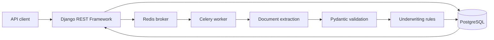

# Loan Processing Platform


Backend application for loan submission, document data extraction, asynchronous processing, and rule-based underwriting recommendations. Built with Django REST Framework, PostgreSQL, Redis, Celery, Pydantic, and an optional OpenAI extraction step.

This repository contains the API, background worker, database migrations, tests, and benchmark scripts. The underwriting output is a software-generated recommendation, **not a production lending decision**.

## Features

- REST endpoints for loan applications and associated documents
- Submission workflow that queues a Celery processing job in Redis
- Document extraction in deterministic mock mode or optional OpenAI mode
- Pydantic validation for structured extraction results
- Underwriting recommendations based on extracted income, liabilities, and risk indicators
- Processing-job status tracking and saved recommendations in PostgreSQL
- OpenAPI/Swagger documentation and load/benchmark scripts

## Architecture



**Processing path:** create a loan, attach document text, submit it, retrieve the processing job status, and inspect the underwriting recommendation. The API returns a submission response while the worker processes the document independently.

## Tech stack

| Layer | Technologies |
|---|---|
| API | Python, Django 5, Django REST Framework, drf-spectacular |
| Database | PostgreSQL, Django ORM |
| Background jobs | Celery, Redis |
| Data extraction | Pydantic, optional OpenAI API |
| Development | Docker Compose, Gunicorn |
| Tests and benchmarks | pytest, pytest-django, Locust, custom Python scripts |

## Getting started

### Prerequisites

Python 3.12, Docker with Compose, and a free local port **5433** for PostgreSQL and **6379** for Redis. The API uses port **8000** by default. If another project is using these ports, adjust the mappings before starting; don't stop unrelated containers.

### 1. Configure the environment

```bash
cp .env.example .env
```

The supplied `.env.example` uses Docker-network hostnames (`db` and `redis`). To run Django and Celery **on the host** while keeping database and Redis in Docker, change these in your local `.env`:

```dotenv
POSTGRES_HOST=127.0.0.1
POSTGRES_PORT=5433
REDIS_URL=redis://127.0.0.1:6379/0
USE_FAKE_AI=true
```

Leave `OPENAI_API_KEY` unset for deterministic mock extraction. Do not commit `.env` or use the sample passwords outside local development.

### 2. Start dependencies

```bash
docker compose up -d db redis
```

### 3. Install and migrate

```bash
python3.12 -m venv .venv
source .venv/bin/activate
python -m pip install -r requirements.txt
python manage.py migrate
```

### 4. Start the API and worker

In one terminal:

```bash
python manage.py runserver 127.0.0.1:8000
```

In a second terminal, with `.venv` activated:

```bash
celery -A config worker -l info --pool=solo
```

Alternatively, use `docker compose up --build` to run the API and worker inside containers with the default Docker-hostname configuration in `.env`. Check existing ports first.

### API documentation

- Swagger UI: `http://127.0.0.1:8000/api/docs/`
- OpenAPI schema: `http://127.0.0.1:8000/api/schema/`

## Example API flow

**1. Create a loan**

```bash
curl -X POST http://127.0.0.1:8000/api/loans/ \
  -H 'Content-Type: application/json' \
  -d '{"applicant_name":"Alex Morgan","applicant_email":"alex@example.com","requested_amount":"50000.00","purpose":"debt_consolidation"}'
```

**2. Attach document text** (replace `LOAN_UUID` with the created loan ID):

```bash
curl -X POST http://127.0.0.1:8000/api/documents/ \
  -H 'Content-Type: application/json' \
  -d '{"loan":"LOAN_UUID","kind":"paystub","filename":"paystub.txt","text_content":"Monthly income: $8000. Monthly liabilities: $1200. Employment status: employed."}'
```

**3. Submit**

```bash
curl -X POST http://127.0.0.1:8000/api/loans/LOAN_UUID/submit/
```

**4. Query results**

```text
GET /api/processing-jobs/?loan=LOAN_UUID
GET /api/recommendations/?loan=LOAN_UUID
```

The submit action requires at least one document and returns HTTP 202 with a processing-job ID.

## API reference

| Resource | Routes |
|---|---|
| Loans | `GET/POST /api/loans/`, `GET/PUT/PATCH/DELETE /api/loans/{id}/`, `POST /api/loans/{id}/submit/` |
| Documents | `GET/POST /api/documents/`, `GET/PUT/PATCH/DELETE /api/documents/{id}/` |
| Processing | `GET /api/processing-jobs/`, `GET /api/processing-jobs/{id}/` |
| Recommendations | `GET /api/recommendations/`, `GET /api/recommendations/{id}/` |

## Extraction modes

`USE_FAKE_AI=true` enables a deterministic parser intended for tests and local development. With `USE_FAKE_AI=false` and a valid `OPENAI_API_KEY`, the application requests structured data from the configured model and validates it against a Pydantic schema. The code falls back to mock extraction when no API key is configured. The mock path should not be interpreted as a measured OpenAI extraction.

## Measured benchmarks

Results below are from the saved benchmark output in this repository, not service-level guarantees. Hardware, dataset size, and workload can change the results.

### Structured extraction evaluation

| Metric | Observed result |
|---|---:|
| Synthetic documents evaluated | 100 |
| Schema-valid responses | 100/100 (100%) |
| Mean extraction time | 1.72 seconds |
| P95 extraction time | 2.69 seconds |
| Maximum extraction time | 8.65 seconds |

Source: `benchmark-results/ai/ai-evaluation.json`. Reproduce with `USE_FAKE_AI=false AI_EVAL_COUNT=100 python benchmarks/ai_evaluation.py` after configuring an API key. A valid schema does not establish factual extraction accuracy.

### API load test

| Metric | Observed result |
|---|---:|
| Requests | **17,256** |
| Failures | 0 |
| Aggregate throughput | 297.23 requests/second |
| Aggregate P95 latency | 21 ms |
| Worst endpoint P95 in saved summary | 24 ms |

Measured with Locust. Source: `benchmark-results/api/loan-api_stats.csv`. The output file reports 17,256 requests; this corrects an older README count of 17,392. Run `./benchmarks/api_benchmark.sh` to collect a new sample.

### Indexed versus unindexed PostgreSQL lookups

| Lookup | Indexed median | Unindexed median | Time reduction |
|---|---:|---:|---:|
| Loan status | 0.027 ms | 2.763 ms | 99.02% |
| Applicant email | 0.012 ms | 0.4935 ms | 97.57% |
| Document | 0.015 ms | 0.339 ms | 95.58% |

Average measured lookup-time reduction: **97.39%** across three queries. Source: `benchmark-results/database/database-benchmark.json`. These are isolated query timings, not end-to-end API speedups. Rerun `python benchmarks/database_benchmark.py` for a new sample.

## Testing

```bash
python -m pytest -q
```

Tests currently cover extracted-data schema validation and underwriting rules. GitHub Actions runs the suite with an isolated PostgreSQL service and mock extraction. Additional API and Celery integration tests remain future work.

Generate synthetic loan records using:

```bash
python manage.py seed_loans --count 1000
```

## Repository layout

```text
apps/                 # loans, documents, processing, underwriting
config/               # Django and Celery settings, URLs
benchmarks/           # performance and extraction evaluation scripts
benchmark-results/    # saved measurement outputs
loadtests/            # Locust scenario
tests/                # pytest suite
docker-compose.yml
Dockerfile
requirements.txt
manage.py
```

## Current limitations

- Document creation currently accepts document metadata and text content; file upload, PDF parsing, OCR, and object storage are not implemented.
- The underwriting rules and extraction are for demonstration. They are not validated for regulated credit decisions.
- Authentication and role-based permissions are not enforced in the current API; do not expose it publicly as-is.
- Development defaults use broad Django allowed hosts and debug settings. Restrict those before any deployment.
- API load and AI extraction benchmarks use their documented test setups; they are not production claims.

